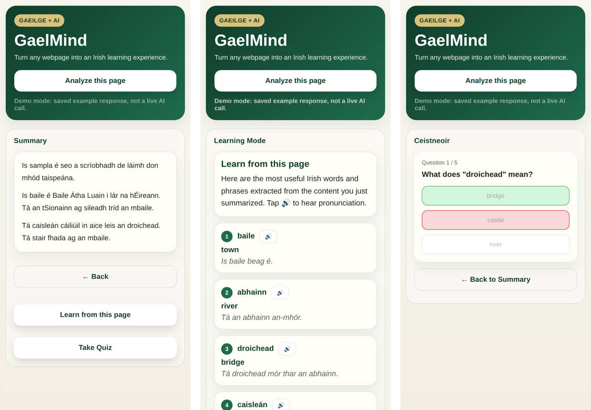
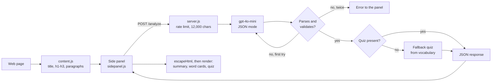

# GaelMind (GaeligeWeb)

GaelMind is a Chrome extension that turns the page you are reading into a short Irish lesson. Click **Analyze this page** in the side panel, and a small Node server sends the page's title, headings and paragraphs to gpt-4o-mini. It gets back summaries in English and in simpler Irish at three lengths, 10–20 Irish words from the page with examples, and a 5-question quiz on those words. The side panel walks you through it: pick a language, pick a reading depth, then study the word cards or take the quiz.

Built at an Irish-language hackathon at Dogpatch Labs, Dublin, in March 2026.

   



[How it works](#how-it-works) · [Keeping the AI's answer usable](#keeping-the-ais-answer-usable) · [Run it](#run-it) · [What I'd do differently](#what-id-do-differently)

> [!IMPORTANT]
> The screenshot was taken on 20 Oct 2026 by running the real side panel against the real server with `DEMO_MODE=1`. In that mode the server returns the hand-written example in `server/demo/sample_response.json` (a short text about Athlone) instead of calling OpenAI, and the panel shows "Demo mode" in its status line. The quiz shows one wrong answer on purpose, to show the feedback.

## How it works



| Part | File | What it does |
|---|---|---|
| Content script | `extension/content.js` | on request, collects the page title, up to 10 `h1–h3` headings and 20 paragraphs longer than 40 characters |
| Service worker | `extension/background.js` | opens the side panel when the toolbar icon is clicked |
| Side panel | `extension/sidepanel.html/.js/.css` | five steps: language → reading mode → summary → word cards (🔊 reads the word with the browser's `ga-IE` voice, if installed) → quiz |
| Server | `server/server.js` | Express on port 3012: per-IP rate limit (20 requests/minute, in memory), trims input to 12,000 characters, builds the prompt, calls the model, validates the answer |

The server sits between the extension and OpenAI so the API key never ships inside the extension.

## Keeping the AI's answer usable

A side panel cannot render half a JSON object, so most of `server.js` is about making the model's answer safe to use:

1. **JSON mode** (`response_format: json_object`) so the reply is syntactically valid JSON.
2. **Fallback parsing**: strip a ```` ```json ```` fence, cut to the outermost `{…}`, remove trailing commas, then try `jsonrepair`.
3. **Validation** (`validateOutput`): all four keys present, every summary a non-empty string, at least 4 vocabulary items and 3 quiz questions.
4. **Retry once** if parsing or validation fails.
5. **Fallback quiz**: if the quiz is missing or too short, build one from the vocabulary.
6. **Escape before rendering**: everything the model returns came from a third-party page, so the side panel escapes it before putting it into HTML (`escapeHtml` in `sidepanel.js`).

## Run it

```bash
# 1. server
cd server
npm install
DEMO_MODE=1 npm start                         # no API key needed
# or: echo "OPENAI_API_KEY=sk-..." > .env && npm start

# 2. extension
# chrome://extensions → Developer mode → Load unpacked → choose the extension/ folder
# open any article, click the GaelMind icon, then "Analyze this page"
```

`API_BASE_URL` at the top of `extension/sidepanel.js` points at `http://localhost:3012`.

## What I'd do differently

Fixed after the hackathon:

- **`.gitignore` was saved as UTF-16**, which git cannot read, so nothing was ignored, including `server/.env` with the API key. It is now plain UTF-8, and `git check-ignore` confirms `.env` and `node_modules/` are ignored.
- **The answer was cut off.** At the upper end of the lengths the prompt asks for, the reply is about 2,000 words, but `max_tokens` was 1,200, so long pages produced truncated JSON. That was why `jsonrepair` was needed so often. Now 4,096, plus JSON mode.
- **Model output went into `innerHTML` unescaped.** A page could make the model echo HTML into the side panel. Served as a plain page, an `` in a vocabulary item ran script before the fix and does not after. Inside the real extension, Manifest V3's content security policy blocks that inline script, but injected HTML such as fake links would still render.
- All five steps were visible before the first analysis; now they appear after it.

Still open:

- **Word choice is left to the model.** A frequency list of Irish words, plus some memory of what the learner already knows, would make it a learning tool rather than a demo.
- **No tests**, and the rate limiter lives in memory, so it resets on restart and doesn't work across several server instances.
- The quiz always tests Irish → English meaning; typing the Irish word would test recall, which is harder and more useful.
